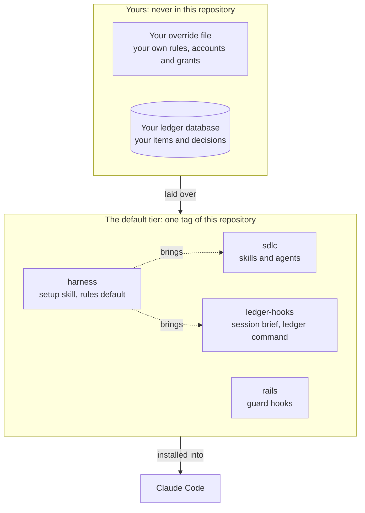
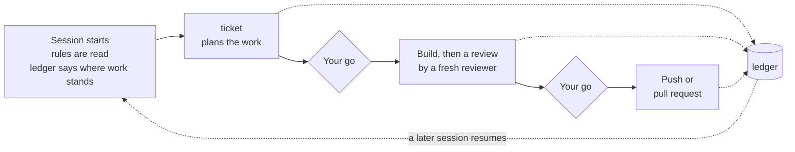

# Harness core

[](LICENSE)

One install that gives every Claude Code session on your machine the same
working agreements, a record of the work that outlives the session, and guards
on the commands you cannot take back.

**New here?** [Why](#why) says what it is for. [How it fits
together](#how-it-fits-together) shows the pieces on one diagram. [Install the
default tier](#install-the-default-tier-alpha) is a few commands and one setup
skill. This is an alpha, so read [Status](#status-alpha) before you install.

## Why

A coding agent starts each session knowing nothing about how you work. It does
not know that a change is read by someone who did not write it before it
merges, that a test counts only once it has been seen to fail, or that a push
to main waits for you. It does not know what was decided yesterday, or where
the last session stopped. So you tell it: in one project's instructions file,
in a prompt, in the next project's instructions file, and again when a long
session has forgotten.

On one project that is a chore. Across many, the upkeep grows until it is the
job. The rules drift apart from project to project. The state of the work
lives in notes that one session wrote and the next one has to trust. And an
instructions file can ask but cannot stop: an agent that was told never to
delete outside the project can still run the `rm`.

A harness is the layer around the agent that carries all of this, so that
neither you nor the session has to: the rules every session reads, the record
every session writes to, and the checks that run whether or not the agent
remembers the rules. This repository is the default tier of one such harness.
It grew over months of daily use on one person's machines, and it is the part
of that setup that is not about that person, packaged so that someone else can
install it and take it out again.

What that looks like in practice:

- **The same agreements in every session.** Setup places one rules file that
  every session and general-purpose subagent reads. It says that a change is
  reviewed by something that did not write it, that evidence is a command
  someone else can rerun, and that a person merges. Your own rules go in a
  second file beside it, and setup never overwrites a file you already have.
- **Work that survives the session.** The `ticket` skill writes each piece of
  work to the ledger, a local database of items and decisions, and stops
  twice for your go: once on the plan, and once before anything leaves your
  machine. End the session part way through, say "Resume the ticket" with its
  id in a new one, and the work carries on from where it stopped. If the
  earlier session crashed, the skill first asks you to confirm it is gone.
- **Guards that do not rely on the agent remembering.** With the `rails`
  plugin, an `rm` that reaches outside the current worktree is denied, and a
  push to main or a force-push asks first, or is denied if you set it so. In
  Claude Code's auto mode an ask is not yet a sure stop, so set deny where you
  need one. A guard never allows a command on its own, and each guard's
  default hook blocks the command when it cannot run.
- **An install you can read first and take back out.** Setup shows every file
  and every setting it will write before it writes one. Its optional sandbox
  item offers write access to the ledger folder. Uninstall removes what setup
  placed, keeps and names any file you have changed since, and leaves your
  ledger database, because that is your data.
- **One tag, one tested set.** The two plugins that come from other
  repositories are each fixed to a full commit id, and the two in this
  repository by the tag you install from. Nothing follows a branch, and
  nothing updates by itself.

The purpose and the thirteen principles the rules come from are written down
in [harness-definition.md](skills/_lib/standards/harness-definition.md).

## What this is

A Claude Code plugin marketplace with four plugins, and the shared files they
are built on.

| Plugin | What it gives you | Where it comes from |
|---|---|---|
| `harness` | The one you install. It carries the setup skill, which also checks and uninstalls, the rules default and a starter for your own overrides. | this repository |
| `sdlc` | The skills and agents, including `ticket`. Installing `harness` brings it. | the public [skills](https://github.com/smithadifd/skills) repository, at a pinned commit |
| `ledger-hooks` | The ledger's hooks, which print where work stands when a session starts, and the `ledger` command. Installing `harness` brings it. | the public [ledger](https://github.com/smithadifd/ledger) repository, at a pinned commit |
| `rails` | Two guard hooks that run on every shell command. At this tag you install it on its own. | this repository |

The shared files are the written standards agents work to, small Python
modules that find the harness and read its configuration, a local index for
recalling past sessions, and a copy of the ledger. Other repositories take
them by copying them at a pinned tag, which [For repositories that vendor the
core](#for-repositories-that-vendor-the-core) describes. Someone who only
installs the plugins never needs that part.

The difference is in how it is built. Every change here passed two independent
model reviews and tests that fail without it. What this page says about the
files setup writes, what uninstall leaves behind and which versions an install
shows is checked by tests against the code, so the page cannot drift from the
behaviour unnoticed. A CI check fails the build when any file names a person,
a machine or a home folder. What the guards do not catch is written down, one
line per limit, in [KNOWN-LIMITS.md](KNOWN-LIMITS.md).

## How it fits together

The pieces, and what stays yours:



One piece of work, from the first session to the next:



With `rails` installed, both guards check every shell command along the way.

Two sibling repositories are published separately, and both are public:

- **[ledger](https://github.com/smithadifd/ledger)** is the item ledger, a
  tracker and decision log for agents. It works on its own, and a copy of it
  lives inside this repository (see "The ledger inside" below).
- **[skills](https://github.com/smithadifd/skills)** holds the skills and
  agents, each usable on its own. This repository holds none of them: its
  `skills/` folder has only shared library files and standards.

This repository is what ties them into one install.

## Who it is for

Someone who uses Claude Code on more than one project, sets their own rules,
and wants the habits of review, evidence and a human merge to hold without
restating them in every project. At this stage you should be comfortable
reading shell and Python, because the code is the last word on what it does.

## What it is not

- **Not a way to run many agents at once.** The harness this came from also has
  a delegation loop, which plans sprints and runs many agents in parallel. It
  is a heavier setup that sits on top of the core, and it is not what someone
  else installs. A few standards here mention it, but its machinery is not in
  this repository.
- **Not one person's setup.** Nothing here may name a person, a machine or a
  home folder, and a CI check fails the build if it does. Each person's own
  accounts and settings go in an override layer on top of the core, which this
  repository does not hold.
- **Not a sandbox.** The guards catch a destructive command written by
  mistake. They do not see one that is hidden on purpose, and
  [KNOWN-LIMITS.md](KNOWN-LIMITS.md) lists what they miss. Confinement is
  Claude Code's own sandbox, which setup offers to switch on.

## Status: alpha

This is the working core of my own agent harness, published as it is.

- **Held to a high bar:** every change here passed two independent model
  reviews and tests that fail without it.
- **Not done:** docs, onboarding, and any promise of stability. Interfaces
  change between tags without notice.
- **If you use it:** pin a tag and expect to read the code. There is no support.

## Install the default tier (alpha)

The marketplace in `.claude-plugin/marketplace.json` is named `harness-core`.
At this tag it lists four plugins:

- `harness`, a folder in this repository (`plugins/harness/`). It is the one
  plugin a person installs, and it depends on the other two. It carries the
  setup skill (`/harness:setup`, which also checks and uninstalls), the script
  behind it, the rules default, the override starter and the instance folder
  template.
- `sdlc`, the skills, from the public skills repository.
- `ledger-hooks`, the ledger's hooks, from the public ledger repository.
- `rails`, a folder in this repository (`plugins/rails/`): the guard hooks.
  `harness` does not depend on it yet, so installing `harness` does not bring
  it; install it on its own, and store its three options at their defaults:

  ```text
  claude plugin install rails@harness-core
  printf '{"push_to_main":"ask","force_push":"ask","commit_style":"off"}' | claude plugin configure rails@harness-core --values-stdin
  ```

  A bare install, with no options stored, still guards: the git guard asks
  before a push to main or a force-push as soon as it is installed. But until
  all three options are stored, an interactive session shows a non-blocking
  "Plugin option push_to_main isn't set" hook error on Bash calls, so store
  them as above. Start a new session, or run `/reload-plugins`, to load it.
  See "The rails plugin" below.

`sdlc` and `ledger-hooks` are each fixed to one full commit id on a release
tag, and `harness` and `rails` are fixed by the tag of this repository you add
the marketplace at. A
tag of this repository therefore names one tested set; nothing resolves to a
branch or a range. CI validates both manifests with `claude plugin validate
--strict` on a pinned Claude Code version (2.1.325), and a test fails when a
plugin's folder or manifest is missing or a pin is not a full commit id. CI
also asks the GitHub REST API, with no credential, which commit each external
plugin's release tag names now, and fails when it is not the pinned commit
(`scripts/check-marketplace.py --source`).

**Status at this tag.** Setup stores three options on the ledger plugin and
makes the first ledger write through the ledger plugin's `ledger` command. The
ledger plugin pinned here (`v0.7.0`) declares those three options
(`ledger_db`, `ledger_operator` and `ledger_harness`) and ships the `ledger`
command, so `/harness:setup` gets past its ledger options step. The skills
plugin pinned here is `sdlc` at `v1.6.1` (commit
`610af6a5f87a4b7380edee2544ff7cc0b69d0bd6`); it carries the `ticket` skill
that "First use" below names. Install, update and uninstall work as written
below.

You need Claude Code, `git` with your name and email set (`git config --global
user.name` and `git config --global user.email`: the ticket skill makes
commits, and without them git signs each one with an address it makes up from
the machine's name), network access to GitHub, and Python 3.11 or later
for the ledger's command. The repository must be public or shared with your
account. Run the install commands in a shell, not in a session. Add the
marketplace by its full URL with `#<tag>`: that form checks out exactly the
tag's commit, while the bare `owner/repo` form follows the main branch whatever
tag you meant. Do not add it from a local clone: a plugin installed from a
clone is served from it, so the clone can never move.

### Using it over SSH

On macOS, the login keychain is normally locked in an SSH session. Logins
made at the Mac's screen may therefore be unavailable over SSH. Before
installing on a remote Mac:

1. **Give Claude Code a token.** If it says `Not logged in · Please run /login`
   despite a login at the screen, run:

   ```sh
   claude setup-token
   ```

   Complete the browser login on a machine where you can open the URL it
   prints. Keep the resulting token in the SSH user's shell profile, exported
   as `CLAUDE_CODE_OAUTH_TOKEN`, and load that profile before starting Claude
   Code. Keep the profile private to that user; never commit the token.

2. **Sign in to GitHub CLI without the keychain.** `gh auth login --web` can
   hang without an error and leave no login stored. Instead, put a personal
   access token in a private file outside the repository and read it on stdin:

   ```sh
   gh auth login --with-token --insecure-storage < '<token-file>'
   ```

   Replace `<token-file>` with your file's path. For a classic token, `gh`
   requires the `repo`, `read:org` and `gist` scopes. `--insecure-storage`
   stores the token in plain text instead of the locked keychain, so later SSH
   sessions can use it. Keep both that credential file and the input file
   readable only by your user; never commit either.

3. **Configure git before the first push.** A GitHub CLI login alone does not
   give git a credential helper. An HTTPS push may fail with
   `fatal: could not read Username for 'https://github.com': terminal prompts disabled`,
   or stop at a username prompt. After logging in, run:

   ```sh
   gh auth setup-git
   ```

   This makes git use GitHub CLI's stored token for HTTPS authentication.

### Install

```text
claude plugin marketplace add https://github.com/smithadifd/harness-core.git#vX.Y.Z
claude plugin install harness@harness-core
claude plugin list
```

`vX.Y.Z` is a release tag of this repository: use the current one, which is
`v0.3.4`. Each release moves it, so if this text may be older than the
repository, read the newest tag on the repository's Tags page on GitHub, or run
one command and take the highest version it lists:

```text
git ls-remote --tags https://github.com/smithadifd/harness-core.git
```

The list shows `harness`, `sdlc` and `ledger-hooks` enabled. Its version
column is each plugin's own version, not this repository's tag: `harness` and
`rails` show 0.2.0, the version in their manifests at this repository's tag,
and `sdlc` shows 0.16.1, which is the skills release `v1.6.1` at the pinned
commit; `ledger-hooks` shows 0.7.0, which is the ledger release `v0.7.0` at
the pinned commit. Start a new session, or run `/reload-plugins` in an
open one, to load them. On its first run in a folder, Claude Code asks whether
you trust it, and the highlighted answer is "No, exit": move to "Yes" before
you press Enter.

Claude Code, not this repository, writes the install's records: the
marketplace's declaration and one `enabledPlugins` entry per plugin in your user
`settings.json`, and a plugin cache in your Claude folder. Nothing is installed
outside your Claude folder.

### Set up

The main path is the setup slash command in a session:

```text
/harness:setup
```

The skill asks you to type the operator name the ledger stamps on what you
write, as a plain question in the chat: type the name as your next message
(a picker's "Type something" choice can dismiss the question in Claude Code
2.1.326). It then shows a plan: every file it will create, the three ledger
options, the command that makes the first ledger write, and each optional
settings change as the exact text to be added. The plan may appear collapsed
under "Ran 1 shell command", with only a one-line reply in view: press ctrl+o
to show it, and read it before you answer the question about the files.
Nothing is written until you answer. You give one yes for the files, the
ledger options and the first ledger write together, then one yes or no for
each optional settings change on its own. Saying no to every optional change
leaves a complete setup. Setup then applies the plan, makes the
first ledger write, checks the result (it runs the doctor itself, so you need
not run `doctor` again straight after) and ends by telling you to start a new
session: the ledger's options reach a session's commands, and the rules default
is read, only when a session starts.

If a file is already at the rules default's path, setup stops and writes
nothing; it never overwrites or merges. If you already have an override file
at its path, setup leaves it as it is and uninstall leaves it too.

Before the closing note, the skill also offers an instance folder (below). It
asks once, and runs it only if you say yes.

#### Set up from a shell

Use this path when you do not have an open Claude Code session, including
from a headless agent's shell. It needs no session or nested `claude -p`
call. Plugins installed during a session load only in a new session or
after `/reload-plugins`; installing them does not make `/harness:setup`
available in that same session automatically.

After `claude plugin install harness@harness-core`, the script is at
`$HOME/.claude/plugins/cache/harness-core/harness/<version>/setup.py`, where
`<version>` is the installed plugin's cache version, not the repository tag.
Find the available copies:

```sh
ls -d "$HOME"/.claude/plugins/cache/harness-core/harness/*/setup.py
```

Choose the copy from the install you want to set up, replacing `<version>`
below. The ledger command is normally on a session's PATH, not your shell's.
Find the installed command and replace `<ledger-command-directory>` with
its containing directory (an absolute path, without the final `/ledger`).
If several versions are listed, choose the one from the same install:

```sh
setup_py="$HOME/.claude/plugins/cache/harness-core/harness/<version>/setup.py"
find "$HOME/.claude/plugins/cache/harness-core/ledger-hooks" -type f -name ledger
export PATH='<ledger-command-directory>':"$PATH"
```

Keep that shell open for the commands below. Python 3.11 or later and the
`claude` CLI must also be on PATH. Replace `<operator>` with the name the
ledger should stamp on your writes, using the same value in all three
commands. `claude-code` is the harness name; replace it consistently if you
use another.

1. **Read the plan before approving any write.** This command writes nothing:

```sh
python3 "$setup_py" plan --home "$HOME" --operator '<operator>' --harness 'claude-code'
```

Read every `FILE`, the three `LEDGER` options and the `FIRST LEDGER WRITE`
command. These have no approval IDs: choosing to run `apply` and
`ledger-init` below approves them. Each `OPTIONAL <id>` names one optional
settings change and prints its exact text; only those IDs go to `--approve`.
For example, `sandbox` and `deny:Read(.env)` are separate IDs.

2. **Apply the files and ledger options.** Run this only after approving the
files, the ledger options and the first ledger write. With no `--approve`,
every optional settings change is left out; the setup is still complete:

```sh
python3 "$setup_py" apply --home "$HOME" --operator '<operator>' --harness 'claude-code'
```

To opt into individual optional changes instead, append one `--approve '<id>'`
per approved ID from your plan to that command, for example
`--approve 'sandbox' --approve 'deny:Read(.env)'`. For `sandbox`, also append
`--sandbox-folder '<folder>'` with the exact absolute folder from the plan
you accepted; do not resolve the database path again to choose that value.
If the plan offers only the sandbox switch, pass `--sandbox-folder ''`
instead. A missing or changed folder approval refuses before configuration
or settings writes. Single-quote each ID and folder: parentheses in a deny ID
are shell syntax when unquoted. Never use `--approve-all`, and never treat
approval of the files as approval of an optional item.

3. **Make the first ledger write.** `apply` does not do this step:

```sh
python3 "$setup_py" ledger-init --home "$HOME" --operator '<operator>' --harness 'claude-code'
```

It creates the database with one closed "Harness setup" topic when absent;
an existing database is kept without a write.

4. **Check the result:**

```sh
python3 "$setup_py" doctor --home "$HOME"
```

`FAIL` means the setup is not complete; `note` is information. If any
command refuses with `setup:`, stop and read the refusal; do not work
around it or edit the files by hand.

These are the same script commands the skill runs, with the same result:
the rules default, override starter, setup record, lock, stored ledger
options and first ledger write described below. The same refusal applies
when a rules default already exists: setup does not overwrite or merge it.
An existing override is kept. Start a new session when finished so it reads
the rules and stored ledger options.


#### What setup writes

These are the files the plan lists, under your home folder. Setup opens no file
you already had. The plan lists exactly these and the checks in CI fail if a
setup run writes another.

| Path | What it is |
|---|---|
| `.claude/rules/harness.md` | the rules default, which every session and general-purpose subagent reads |
| `.claude/rules/harness-local.md` | the override starter: HTML comments only, grants nothing, for your own rules |
| `.claude/plugins/harness-core/harness/setup-record.jsonl` | the record of what setup wrote, which uninstall reads and deletes last |
| `.claude/harness-setup.lock` | an empty lock file, so two setup runs cannot overlap |
| `.local/share/ledger/ledger.db` | the ledger database, created by the first ledger write only when it is absent |

Setup also asks Claude Code to store the ledger plugin's three options
(`ledger_db`, `ledger_operator` and `ledger_harness`), which Claude Code keeps
in your user `settings.json` and deletes when the plugin is uninstalled.

The optional settings changes are the sandbox switch (`sandbox` set to
`{"enabled": true}` with `filesystem.allowWrite` listing the ledger database's
absolute parent folder), six deny rules that stop the agent reading secret
files: `Read(.env)`, `Read(.env.*)`, `Read(**/.env)`, `Read(**/.env.*)`,
`Read(**/*.pem)` and `Read(**/*.key)`, and turning off Claude Code's prompt
suggestions (`promptSuggestionEnabled` set to `false`). Each is added only
when absent, a deny rule is appended after the ones you have, nothing you
have is changed, removed or reordered, and each addition is recorded so
uninstall can take out exactly it. The sandbox proposal shows the exact folder
before you accept it, and offers it only when that folder is strictly inside
home by file identity. A ledger database outside home no longer gets a sandbox
write path: setup proposes only `{"enabled": true}` and says why. Home itself
and anything that cannot be resolved safely also get only that bare proposal.
The default ledger lives under home, so the default setup is unchanged.
Claude Code keeps its protected paths protected and
combines write paths from different settings scopes. Setup adds no allow rule,
extra working directory or automatic permission for sandboxed commands.

If you are unsure what to answer to the optional changes:

- **The sandbox switch.** No is safe. Yes runs the agent's shell commands
  inside Claude Code's sandbox, which limits what they can write and reach on
  the network, so a command that needs more can fail or ask first. If you say
  no, you give up that confinement, and the permission prompts still apply.
  Say yes when you want it, including the ledger folder write path shown in
  the plan. An existing sandbox block is never extended. If you later change
  the block or add a write path, uninstall keeps the whole block. Update leaves
  settings alone and reports when the recorded sandbox proposal differs.
- **The six deny rules.** Yes is recommended. They stop the agent reading
  `.env` files and `.pem` and `.key` files, and the cost is a refused read when
  you do want it to see one, in which case you paste what it needs. No is
  safe: you give up that stop.
- **Prompt suggestions off.** Claude Code can type a grey suggested reply into
  the prompt box, such as a "yes", and pressing Enter sends it. Yes sets
  `promptSuggestionEnabled` to `false`, so an empty prompt stays empty. No
  leaves the suggestions as they are. It is applied only on your yes, only
  when you have not set that key yourself, and uninstall takes it out again.

Claude Code 2.1.326 makes auto mode the default permission mode for new
accounts. In auto mode a command that you expect to prompt can simply run, so
where this README says a command asks or prompts, it means the manual
permission mode: press shift+tab in a session to cycle to it, and the prompts
appear.

The built-in Explore and Plan agents do not read the rules folder, so the rules
default does not reach them. They are read-only, and the guard hooks will apply
inside them when `rails` arrives.

### Check the setup

```text
/harness:setup doctor
```

Without a session, use `python3 "$setup_py" doctor --home "$HOME"` from
**Set up from a shell**, with the same script path and PATH.

It reads and writes nothing. It reports the placed files (unchanged, changed
since setup, or missing), the settings items setup added, the stored ledger
options, whether the ledger database file exists, and whether Python 3.11 or
later and the `ledger` command are found. A line starting `FAIL` is a problem;
`note` is information.

### First use

The ledger is where your work's state lives, and the `ticket` skill (from the
`sdlc` plugin) is how you put work into it.

- **File an item and work it.** Ask in plain words in a session, for example:
  "file one small item to add a README line, and work it with the ticket
  skill". The skill writes the item to the ledger, prints a plan, and stops
  twice for your go: once on the plan, and once before anything leaves your
  machine (a push or a pull request). It prints the item's id; keep it.
- **Stop and resume.** You can leave a ticket in a session and pick it up in
  another. In the new session say "Resume the ticket <id>". If the earlier
  session was ended with `/exit`, the skill reopens the ticket by its id and
  carries on from where it stopped, and asks nothing. If the earlier session
  crashed instead, the skill asks you to confirm that session is gone before
  it releases the old claim. The ledger's `resume` subcommand (below) prints
  where work stopped and the command that continues it.
- **Leaving while a build runs.** If you end a session with `/exit` while a
  build is running, Claude Code opens a "Background work is running" dialog
  with three choices: "Exit and stop tasks", "Move to background and exit"
  and "Stay". Choose "Exit and stop tasks" (the first): it stops the build
  with the session, which is the case "Resume the ticket" picks up. Moving it
  to the background leaves the build running after you have gone, so a resume
  would meet work that is still running.
- **A diff panel may open.** While a ticket closes, Claude Code may open a
  diff side panel on its own. Type `/diff` to close it.
- **The `ledger` command.** It is on the PATH of a Claude Code session, not of
  your own shell: in a terminal, `ledger` is "command not found". Run it
  through a session: ask for the command by name, and ask the session to paste
  the command's output into its reply, because Claude Code collapses a tool's
  output ("Ran 1 shell command") and a session can say the output is above
  when you cannot see it. The session already holds your stored database path
  and operator. The subcommands a person needs:

  | Command | What it shows |
  |---|---|
  | `ledger resume` | where each open item stopped, and the command that continues it |
  | `ledger decisions` | the decision records, with their current standing |
  | `ledger events --item <id>` | every event of one item, newest first, including those `export-item` hides |
  | `ledger export-item <id>` | one item's events; ephemeral ones decay after the item closes, so this can show fewer than `events` |
  | `ledger search <words>` | full-text search over items, decisions, standards and ADRs |

  `ledger --help` lists the rest.

### Make an instance folder (optional)

Setup can also make an instance folder: a new folder of your choosing, made a
local git repository, for plans and decisions in markdown. It is offered once
at the end of `/harness:setup` and runs only if you say yes; you can also ask
for it later:

```text
/harness:setup instance
```

You give the folder as an absolute path. It must not exist yet, or must exist
and be empty. Setup refuses a folder that holds anything (a hidden file counts),
a symlink, a file, a path with a `..` part, and a folder under your `.claude`
folder, and it needs `git` on your PATH. The skill prints the plan (each file
with its text, and the `git init`) and writes nothing until you say yes. These
are the files it makes, inside the folder, and then `git init`:

| Path | What it is |
|---|---|
| `README.md` | what the folder is, what goes in it and what goes in the ledger |
| `.gitignore` | keeps a ledger database out of the repository if one is ever put there |
| `roadmaps/README.md` | what belongs in `roadmaps/`: plans and the order of work |
| `decisions/README.md` | what belongs in `decisions/`: the reasoning behind each decision |
| `standards/README.md` | what belongs in `standards/`: local overrides of the harness standards |

The folder holds markdown only. It holds no ledger database (the ledger keeps
its own, set up above), and no settings file needs editing for it. Setup makes
no commit and adds no remote; commit with your own git identity when you
choose. If anything fails, setup removes what it made and says what it could
not remove. Files and folders are private to you (modes 0600 and 0700).

The folder is yours. Setup records nothing about it, so `doctor` does not list
it and uninstall never touches it; delete it yourself if you want it gone. The
template is `plugins/harness/files/instance/` in this repository.

### Update to a newer tag

Nothing updates by itself: a marketplace added by URL does not auto-update. The
tag you added is recorded with the marketplace, and no update command moves it.
Confirmed on Claude Code 2.1.325:

- `claude plugin marketplace update harness-core` succeeds and leaves the
  marketplace at the tag it was added at.
- `claude plugin update harness@harness-core` reports that the plugin is
  already at the latest version.
- Adding the marketplace again at a newer tag while it is still registered is
  refused: the command exits 1 and says the source does not match the
  marketplace's recorded entry.

So the only way to move is to remove the marketplace, add it again at the newer
tag and install `harness` again. This sequence was confirmed, and it brings the
three plugins back (`rails` too only when you install it again as above):

```text
claude plugin marketplace remove harness-core
claude plugin marketplace add https://github.com/smithadifd/harness-core.git#vX.Y.Z
claude plugin install harness@harness-core
```

Removing a marketplace uninstalls every plugin installed from it (`harness`,
`sdlc`, `ledger-hooks` and `rails`, when you installed it). The command says it
also deletes their saved options, secrets and data where it can, so check any
option you had set afterwards. Whether an option survives the remove was not tested: the ledger
hooks declare no option at this tag. `claude plugin configure` takes the full
plugin id, for example `ledger-hooks@harness-core`. Start a new session, or run
`/reload-plugins`, to load the new set.

The installed rules default is a file setup placed, not a plugin file, so
moving the marketplace does not change `.claude/rules/harness.md`. After the
plugins are at the newer tag, replace that file without touching the override
or the settings items:

```text
/harness:setup update
```

`update` replaces `harness.md` with the installed plugin's default only when
the installed file's hash still equals the hash in the setup record, then
writes the new hash to the record. If you have edited the file since setup, it
refuses by name and writes nothing. A missing record, a missing installed
file, or a hash it cannot read also refuses by name. `/harness:setup doctor`
prints `newer default available` only when the installed file still matches
the setup record and differs from the plugin's default.

### Uninstall

Three steps, in this order:

1. In a session, run `/harness:setup uninstall` first. It reads the record of
   what setup wrote, shows what it will remove, asks you to answer yes or no
   before it removes anything, and then removes it: the two placed
   files if they are unchanged since setup, and each settings change it added
   that is still where it put it. A file you have edited, and a settings item
   you have moved or changed, is kept and named. The ledger database is kept,
   and its path is shown, because it is your data. The command's own output
   names only what it kept, what was already gone, the ledger database and the
   setup record it removed; it does not list the placed files and settings
   items it took out one by one. No hook runs at uninstall, which is why this
   comes first.
2. In a terminal, uninstall the plugin and the dependencies its install pulled
   in: `claude plugin uninstall harness@harness-core --prune -y`. The `-y` is
   needed when the command is not run from an interactive terminal. Without
   `--prune`, `sdlc` and `ledger-hooks` stay installed, and the command tells
   you to run `claude plugin prune`. With it, `harness` and the two plugins its
   install brought in are removed. A plugin you installed on its own before
   `harness` is kept by `--prune`.
3. Remove the marketplace: `claude plugin marketplace remove harness-core`.
   This uninstalls every plugin installed from the marketplace, the
   dependencies included, and also a plugin you installed on its own
   (`rails`, if you installed it).

```text
/harness:setup uninstall
claude plugin uninstall harness@harness-core --prune -y
claude plugin marketplace remove harness-core
claude plugin list
```

The list then shows none of the four (`harness`, `sdlc`, `ledger-hooks` and
`rails`). Steps 2 and 3 were confirmed on Claude Code 2.1.325.

The remove command's output does not list the placed files, so to confirm step
1 took the two rules files out, run this in a terminal:

```text
ls $HOME/.claude/rules/harness.md $HOME/.claude/rules/harness-local.md
```

Each should be reported as "No such file or directory". The second stays if
you edited it, and uninstall named it.

#### What is left after uninstall

Claude Code leaves its own plugin cache until its sweep, its plugin
bookkeeping folders, empty settings keys and session history. What is ours is
this, and nothing else:

| Path | Why it stays |
|---|---|
| `.claude/harness-setup.lock` | the empty lock file, which setup never deletes |
| `.local/share/ledger/ledger.db` | the ledger database: your data, kept unless you ask for it to be deleted |
| `.local/share/ledger/search.db` | the ledger's search index, made beside the database only if `ledger search` ever ran; it can be rebuilt, so it is yours to delete |
| `.local/share/ledger/ledger.db.session-models` | a folder the ledger makes beside the database, of per-session records; it goes with the database if you delete that |
| `.local` | made to hold the database, if it did not exist before |
| `.local/share` | the same |
| `.local/share/ledger` | the same |

`.claude` itself stays when setup made it. An override file you edited also
stays, and uninstall names it. An instance folder you made is not in this table
because setup never recorded it: it stays, untouched.

If you skipped step 1, the two placed files and the record are still there, and
this is the whole manual cleanup: delete `.claude/rules/harness.md`, delete
`.claude/rules/harness-local.md` if you have not edited it, and delete the
folder `.claude/plugins/harness-core/harness`. Any optional settings change
you approved stays in your user `settings.json` until you remove it.

### For maintainers: cutting a tag

A user's copy of a folder plugin changes only when its `version` string does,
so raise `version` in `plugins/harness/.claude-plugin/plugin.json` before each
tag, and move an external plugin's pin (its `ref` and `sha` together) only in
the marketplace file.

## The rails plugin

`rails` holds guard hooks. At this tag it has two, each a `PreToolUse` hook on
every Bash call: the destructive-command guard and the git guard. Claude Code
runs both, and a deny from either wins. Neither ever returns an allow.

### If you installed v0.1.3

At v0.1.3 the git guard's one hook read all three of its options, and Claude
Code does not run a hook until every option it reads is stored: unless you had
stored them, the git guard did not run at all in `claude -p`, and in an
interactive session it failed and blocked every Bash command. Move to a newer
tag as "Update to a newer tag" above says (remove the marketplace and add it
again at the newer tag), then install `rails` again with
`claude plugin install rails@harness-core`, since removing the marketplace
uninstalls it. Until you move, store the three options once
(`claude plugin configure rails@harness-core`, keeping the defaults).
`push_to_main` and `force_push` no longer take `off`: a stored `off` from
v0.1.3 now reads as `ask`.

### The destructive-command guard

- **What it denies.** An explicit `rm` whose targets are not literal paths
  strictly below the current worktree (or a session scratchpad): `/`, `.`,
  home-folder spellings, `..`, `.git` paths, symlinks, globs, variables, a
  plain `rm` with no option, an `rm` that carries a redirection, and an `rm`
  beside a `cd`, `mv`, `ln` or subshell on the same line. A
  `git worktree remove` with `--force`, or of a tree that no registry or
  authorization accepts; a linked tree below a temp folder is accepted. An
  output redirection into an existing path reached through a symlink. Any rm
  or `git worktree remove` that shares the command with a `$(...)` or
  backtick substitution, a process substitution, a heredoc or here-string,
  `eval`, `source` or `.`, `trap`, `alias`, `xargs`, `find -exec`, `env -S`,
  a shell (`bash -c` and the like) or a command word built from a variable is
  denied as `removal_beside_<construct>`, without the guard reading inside
  it; run the removal as its own plain command. A commit or PR message
  written by a heredoc that mentions rm denies the same way; write the
  message to a file and use `git commit -F` or `gh … --body-file`. A removal
  is judged only as a plain command, after `if`, `then`, `do`, groups,
  subshells and the prefixes `sudo`, `env`, `command`, `exec`, `builtin`,
  `nice`, `nohup`, `timeout`, `time`, `setsid`, `stdbuf`, `noglob` and
  `nocorrect`, each also spelled with a directory part (`/usr/bin/env`).
- **Deny only.** It never allows and never asks. For a command it judged and
  accepted, or one it has no opinion on, it exits 0 with no output, and
  Claude Code's own permission flow decides as it would without the plugin.
  A deny is final: the session tells you the guard denied the command and
  never offers a way around it. Whether to run a denied command yourself is
  your call.
- **It fails closed.** A missing program, an engine crash, malformed engine
  output, any engine stderr, an adapter fault or a signal is a deny with a
  named reason, never silence. The hook runs with `"onFailure": "block"`, so
  a hook that times out or cannot start also blocks the command (Claude Code
  2.1.295 or later).
- **What it needs.** `jq`, `wc`, `tr`, `git` and `grep` in one of
  `/usr/bin`, `/bin`, `/usr/local/bin`, `/opt/homebrew/bin` or the Linuxbrew
  bin folder (it never looks them up on `PATH`); `/usr/bin/perl`,
  `/usr/bin/env` and `/bin/bash`; and, for a worktree removal,
  `/usr/bin/git`, `/usr/bin/find`, `/usr/bin/readlink` and `/bin/cat`. A
  missing one denies as `dependency_missing_<name>`, and the reason says where
  it was looked for.
- **Dormant unless armed.** Its lane-registry and cleanup-registry rules, and
  its own log, act only when the delegation loop's variables
  (`LANE_ROOTS_REGISTRY`, `CLEANUP_ITEMS_REGISTRY`, `SEAT_SCRATCH`) are set;
  set to a registry that is absent, untrusted or malformed, they deny every
  removal by name.
- **Extra rm roots (optional).** From a working folder in no git repository,
  an `rm -f` of a regular file strictly below a folder listed in the file
  `.claude/rails/rm-roots` in your home folder is accepted (silent), when the
  file is outside every git repository and the rm is not recursive. The guard
  reads that file in the home folder your account's password entry names,
  never the one `HOME` names.
  It holds one absolute, existing, canonically spelled folder per line; the
  root folder, `/Users`, the home folder and any folder above it are refused.
  The file and its folder must be owned by you and not group- or
  world-writable. With no file nothing changes; an untrusted or malformed file
  denies every rm, as `rm_roots_untrusted` or `rm_roots_malformed`, and the
  reason names the file. A working folder inside a worktree never reads the
  listed folders.
- **What it does not claim.** It is detection, not prevention. It does not
  see a removal whose name is built indirectly (`$CMD -rf /`), a wrapper it
  does not list (`chronic`, `ssh`), an interpreter (`python3 -c`), a script
  file, a git alias, or other deleters (`find -delete`, `rsync --delete`,
  `git clean`). Its list of commands that repoint a later path is closed and
  best-effort. Changes between its check and the command running are not
  seen.

A deny reads `Destructive command guard denied the command (reason=CODE):
HINT.`, then one fixed sentence, the same for every code: `This deny is
final: never use or offer a ! command at the prompt, a sandbox override, or a
settings, permission or allowlist change to get around it; tell the person
the guard denied it, and that running the command themselves is their own
call.` The code names the rule or the fault (`unsafe_rm`,
`unsafe_worktree_remove`, `inherited_git_environment`,
`dependency_missing_jq`, `engine_timeout`, and so on), and the hint says what
to do. It never carries the command or a path from it. Known limits are in
[KNOWN-LIMITS.md](KNOWN-LIMITS.md).

### The git guard

- **What it asks before.** A `git push` that updates main or master: by name
  (`origin main`, `HEAD:main`, `refs/heads/main`, in any letter case, to any
  remote), by `HEAD` or a bare `git push` while main or master is checked out,
  `--all`, `--branches` or `--mirror`, or a matching (`:`) or wildcard
  refspec; and a force, delete, mirror or prune push (`--force`, `-f`,
  `--force-with-lease`, `--force-if-includes`, a `+` refspec, `--delete`, `-d`,
  a `:branch` refspec, `--mirror`, `--prune`, and git's abbreviations of
  them, wherever they stand before `--`). A push it cannot read counts as
  both: a push beside a substitution, `eval`, `alias`, `env -S`, a shell or an
  interpreter running inline code, `xargs`, `find -exec`, `source`, `trap`,
  `flock`, or a heredoc that feeds anything but `cat`, `tee`, `echo`,
  `printf`, `git commit -F -` or `gh … --body-file -`; a word built from a
  variable, glob or brace; an option or wrapper it does not know; a `GIT_`
  variable that selects a repository or injects configuration, or `-c`,
  beside it; or a bare push whose current branch it cannot read.
  Configuration that can define a git alias or re-point a push
  (`git -c alias.…`, `--config-env`, `GIT_CONFIG_*`) asks even with no push
  word.
- **Options.** Three. A bare install works with the defaults, but store all
  three: `push_to_main` and `force_push` take `ask` (the default, and the
  floor) or `deny`, and `commit_style` takes `off` (the default), `ask` or
  `deny`. Set them with the command under "Install the default tier" above, in
  `/config`, or with `claude plugin configure rails@harness-core`. Until all
  three are stored, Claude Code does not run the hook that reads them, the
  defaults apply, and an interactive session shows a non-blocking "Plugin
  option push_to_main isn't set" hook error on Bash calls. A push the guard
  cannot read takes the stricter of
  the first two. With `commit_style` on, the first `-m` message of a top-level
  `git commit` must start with a conventional prefix (`feat:`, `fix:`, `docs:`,
  `refactor:`, `chore:`, `test:`, `ci:`, `build:`, `perf:`, `style:` or
  `revert:`, with an optional scope in parentheses and an optional `!`);
  `--amend`, `--fixup`, `--squash`, `-F`, `-C` and `-c` are exempt, and a
  message it cannot read (a variable, a substitution) fails the check. The
  defaults are written into the plugin's hooks file: the git guard runs twice
  on each Bash call, once with the defaults, on every install, and once with
  your stored options, which speaks only where a stored option is stricter
  than the default. So a stored option can only make a gate stricter, and no
  environment variable, and so no project setting, changes either. A stored
  value other than `ask`, `deny` or `off` denies when its check fires, and
  the reason names the option.
- **Auto mode.** In Claude Code's default auto mode, a push was seen to run
  after a guard ask with no recorded answer. That is not yet confirmed on a
  hands-off run, so do not count on an ask as a hard stop there. Use `deny`
  for a hard stop.
- **Never allows.** It asks, denies or stays silent, and Claude Code's own
  permission flow decides the rest.
- **It fails closed.** As the destructive guard: a missing program, an
  engine crash, malformed engine output, engine stderr beside a silent
  verdict, an adapter fault, a signal or malformed hook input is a deny with
  a named reason, and the hook with the defaults runs with
  `"onFailure": "block"`. The hook with your stored options does not, so it
  cannot block a command while the options are unstored; if it cannot start
  or times out, the defaults still apply (see KNOWN-LIMITS.md).
- **What it needs.** `jq`, `wc` and `tr` from the same trusted roots,
  `/usr/bin/perl`, `/usr/bin/env` and `/bin/bash`; and, only when a bare or
  `HEAD` push needs the current branch, `git` from the same roots. It asks
  that `git` three read-only questions under a scrubbed environment and never
  reads a remote.
- **Unattended.** With the delegation loop's `CLAUDE_SEAT_UNATTENDED=1`, its
  asks are denies, and each one appends a line to `$SEAT_SCRATCH/owed.log`
  when that folder exists. Its log is armed only by `SEAT_SCRATCH`, as the
  destructive guard's is.
- **What it does not claim.** A push named indirectly (a variable from an
  earlier call, a glob or brace spelling, a script, a Makefile or npm target,
  a git alias from a configuration file, a payload sent to another machine) is
  not seen. When the text names the destination branch, the text decides,
  even if configuration written earlier re-points it. Only main and master
  are protected. `gh pr merge`, a web merge and pushes from other machines are
  not local pushes. Changes between its check and the push are not seen.
  Commit style judges only the first message of a top-level commit. The
  source's review of pipelines into a shell with no push in them is not
  carried.

A reason reads `Git guard asks before this command (reason=CODE): HINT.` or
`Git guard denied the command (reason=CODE): HINT.`, and a deny then ends
with the same fixed sentence as the destructive guard's, that the deny is
final and that running the command is your own call; an ask does not carry
it. The code names the gate
or the fault (`push_main_branch`, `push_force`, `push_beside_substitution`,
`commit_nonconventional`, `option_invalid_force_push`,
`dependency_missing_git`, and so on); the hint never carries the command.

## For repositories that vendor the core

This part is for someone who maintains a repository that copies the shared
files. If you only installed the plugins, you can skip it.

### What is in the repository

| Path | What it is |
|---|---|
| `skills/_lib/standards/` | the standards: security, trust ladder, CI, deploy, prompting and the rest |
| `skills/_lib/*.py`, `skills/_lib/*.json`, `skills/_lib/*.tsv` | modules that resolve the harness root, configuration paths, overrides and model pool settings |
| `skills/_lib/recall/` | a local full-text index over agent session transcripts, with a guard that refuses private folders |
| `skills/_lib/ledger/` | the item ledger, itself vendored from the public ledger repository (see below) |
| `.claude-plugin/marketplace.json`, `plugins/harness/` | the plugin marketplace and the `harness` plugin, including its setup skill and the script behind it (see "Install the default tier") |
| `plugins/rails/` | the `rails` plugin: the destructive-command guard and git guard hooks and their tests (see "The rails plugin") |
| `scripts/`, `install-profiles/` | two maintenance scripts and an install profile |
| `skills/_lib/tests/`, `skills/_lib/recall/tests/`, `scripts/tests/` | the tests of the vendored modules |

### Vendored, byte for byte

The vendored files are not installed on their own. A consuming repository
vendors these files: it copies each one, byte for byte and at the same relative path, from a
tagged commit of this repository, and never edits them. `.core-manifest` at
the root is the list of what is vendored: first the folders this repository
owns entirely in every consumer (`tree <folder>/` lines), then every vendored
path, one per line, sorted.

The consumer records the tag, the commit and one git blob id per vendored file
in a pin file, and runs a drift check in its CI. The check fails when a
vendored file differs from the pin (one edited byte, a missing, extra,
re-moded, symlinked or shadowed file), and, against a checkout of this
repository, when the pin differs from `.core-manifest` and the tree at the
pinned commit, or when the commit is not the pinned tag on this repository's
main branch. A change therefore lands here first, is tagged, and reaches each
consumer as one pull request that moves its pin and re-copies the files.

### What is checked where

- Here: the vendored modules' tests run stand-alone, in a tree that holds only
  the vendored files, so a test that reaches outside the vendored set fails.
- In the consumer: closure, the rule that no vendored module reaches a file
  outside the vendored set, is checked by the consumer's layer check at every
  pin move, until this repository grows its own closure check (a planned
  follow-up).

### The ledger inside

`skills/_lib/ledger/` is vendored here from the public ledger repository in
the same way: `ledger-vendor.pin` pins its tag, commit and blob ids,
`scripts/check-ledger-vendor.py` is its drift check, and
`scripts/ledger-vendor-bump.py` moves it. A ledger fix reaches a consumer of
this repository in two steps: a pin move here, then a pin move in the
consumer.

## The default-tier load probe

`scripts/probe-default-tier-load.sh` checks, on a live Claude Code account,
the three load points the default tier's install design rests on. It is
read-only: it runs in a fresh home folder of its own, never in the invoking
user's, and it sets nothing up outside that folder.

```text
CLAUDE_CODE_OAUTH_TOKEN=<token from `claude setup-token`> scripts/probe-default-tier-load.sh
```

It needs `claude`, `python3`, `perl` and (load C) `git` on PATH, and network
access to the public ledger repository for load C. Each probe session is one
short `claude-haiku-5-5` turn. Options: `--timeout <secs>` (default 120 for
each command), `--only <A|B|C>` (repeatable), `-h`. Environment:

- `CLAUDE_CODE_OAUTH_TOKEN` is the only credential used. The probe passes it
  inline to each `claude` command and never prints it. Without it every
  selected load is `UNVERIFIED` and the script exits 2.
- `PROBE_HOME` (optional) is an absolute path to an empty or absent folder to
  use as the target home. The probe refuses it (exit 3, before anything is
  created or any session starts) when it is the invoking user's own home
  folder, is not an absolute path, or exists and is not empty. Use a new
  folder for each run; the probe leaves a folder you chose in place. With it
  unset, the probe makes a temp home and removes it on exit.

Load C does not take its ledger code from the environment. It fetches the
public ledger repository at the one commit pinned in the script (tag `v0.3.1`,
commit `346cb3595180fcea702ebdd37b32ff8c36325ea5`) and is `UNVERIFIED` unless
the fetched HEAD is exactly that commit, because the plugin's hooks run in a
session that holds your token. Moving the pin is a change to the script.

Every `claude` command gets `HOME=<target home>` on that one command, with
`CLAUDE_CONFIG_DIR` and the other variables that could point it at another
config folder or credential removed.

One line is printed per sub-load, then a summary:

```text
<PASS|FAIL|UNVERIFIED> <id> — <evidence>
summary: <n> pass, <n> fail, <n> unverified
```

| Id | What it asks | PASS means |
|---|---|---|
| A1 | does a rules file in the target home's `.claude/rules/` reach the main thread | a one-turn no-tools session returned the file's random sentinel |
| A2 | ... and a general-purpose subagent | the main thread made exactly one top-level `Agent` (or `Task`) call, to one foreground subagent of type exactly `general-purpose`, the stream holds exactly one non-error result for that call, it came back with the sentinel, and the sentinel was not in the prompt the main thread gave the subagent. Any other count of calls or results (two subagents where one replied, a call with two results, none) is `UNVERIFIED` and the line shows the counts |
| A3 | ... and a session after compaction | one `claude` process was sent three messages (a seed turn that never held the sentinel, `/compact`, a question), the stream showed `compact_boundary` before the question's reply, and that reply held the sentinel. This proves the rules file's sentinel is still in that session's context after a compaction in that same session. It does not show whether Claude Code kept the file's text through the compaction or loaded it again, and it says nothing about a session resumed in a new process, which loads the rules file at start |
| B1 | does a plugin option reach the main thread's Bash commands (diagnostic, not counted) | the main thread's `echo` of the exported variable showed the option value |
| B2 | does a plugin option reach a general-purpose subagent's Bash commands (the verdict for B) | the subagent's `echo` showed the value set with `claude plugin configure --values-stdin`, with no Bash run by the main thread and exactly one `Agent` call and one non-error result, as for A2; the exact value seen is printed. The value is read from the subagent's own Bash result, never from the `Agent` call's reply (the main thread could have run the command itself and passed the value on): the `Agent` call must have exactly one `Bash` call of its own, a call whose parent is that `Agent` call, and exactly one result for it of any kind (every result for its id is counted whatever its parent or error flag), which must be a non-error result whose own parent is that `Agent` call. The command must not carry the value and must equal, after stripping surrounding whitespace only, the command the prompt hands the subagent (one shared constant builds both): any other command, even one that names `HARNESS_PROBE_OPTION`, is `UNVERIFIED` and shows the command cut to 120 characters. The main thread must call no tool but the one `Agent` call. A failed condition, no such call, more than one, or a result that is not exactly one such result is `UNVERIFIED` and the line shows the counts; a Bash result without the value is a `FAIL` |
| C | are the ledger plugin's hooks silent before setup | with the pinned ledger plugin installed, no ledger value set, a call-recording `ledger` and a recording `sh` first on PATH: the recording `sh` logged a run of `hooks/session-start.sh` and of `hooks/prompt.sh` under one of two trusted roots: the install folder the install record names, or the `ledger-hooks` folder inside the probe's own ledger checkout (a plugin installed from a local-directory marketplace runs from its source folder, so the checkout is trusted, but only after its HEAD was verified equal to the pinned commit; any other folder is untrusted; the logged script path and each root are resolved to their physical paths and compared by whole path components, and a logged script that does not exist is untrusted whatever its spelling; the plugin runs each hook as `sh "${CLAUDE_PLUGIN_ROOT}/hooks/<name>.sh"`), the stream's `SessionStart` and `UserPromptSubmit` hook responses exited 0 with no output, the recorder was never called past its `command -v` check (its log is created empty in `probe-bin` before the first manifest, so a hook that calls the recorder and then removes, empties or replaces the log changes an entry that was already recorded and is a `FAIL`; the log is read only while it is still a regular file), and no file was left written, changed or removed in the target home or the pinned ledger checkout outside Claude's own state (the `.claude` folder and the `.claude.json` files at the top of the target home). That is shown by a manifest of every entry under both roots (the target home, and the probe's own pinned checkout, where the plugin's hooks run), taken before the session and again after it, and compared for equality. Each entry records its path, type (file, folder, symlink, fifo, socket or device), mode, owner, link count, size, mtime and ctime in nanoseconds, inode, the target of a symlink and the sha256 of a regular file. A symlink is an entry and is never followed; `.cache`, `.npm`, `probe-work`, `probe-bin` and the whole checkout, `.git` included, are compared like any other entry. What is left out is Claude's own state, which is not walked, and four fields of the target home's own root entry (mtime, ctime, link count and size), which follow from the root's entry set, and that is compared in full. Any difference is a `FAIL` that names each added, removed or changed entry and the field that changed (the first 20, then a count). Any error taking or comparing a manifest is `UNVERIFIED`, never a pass: an unreadable entry, a root that is gone, an entry swapped while it was read, a helper that fails or times out, a manifest that does not match the digest the probe holds for it; an error in the before snapshot stops the run before the session. The ledger-call check comes first, then the manifest. The limits of the manifest check are listed below the verdicts. The stream names a hook response by its event and not by its plugin, so it only corroborates; the logged run is what attributes it. With no logged run of either script, the line is `UNVERIFIED` and names what the recording `sh` did log; a stream response of either event that is not clean is a `FAIL` |

What each verdict means:

- `PASS`: a live session in the target home returned the load's own sentinel
  through the route named, or (C) the hook run was seen and was clean.
- `FAIL`: the route ran and the sentinel (or the clean hook run) was not
  there. A FAIL is a finding about the install design, not about the probe.
- `UNVERIFIED`: the route could not be run or its reply could not be read: no
  token, no `claude`, a timeout, an unreadable or oversized reply, a
  compaction the probe could not force in one process, a test plugin that would
  not install, a main thread that answered for the subagent, a subagent that
  ran in the background or was not of type `general-purpose`, a fetched ledger
  commit that is not the pinned one, a pinned commit that ships no hooks
  plugin, an install record that does not name the ledger plugin's install
  folder inside the target home, a session that did not run one of the
  plugin's hook scripts through the recording `sh` (a Claude Code that runs
  hooks with an absolute path to `sh` shows nothing there), or a count of
  subagent calls or results other than one (for B2, also the subagent's own Bash calls or their results), or a manifest of the target home and the pinned checkout that
  could not be taken or compared (C). It is never counted as a pass.

Limits of load C's no-write check, which a `PASS` does not claim past:

- An entry that is not Claude's own state and was created and removed again at the top level of the target
  home during the session leaves no trace, because the home root entry's mtime, ctime, link count and size
  are not compared. The same in a subfolder is caught: it moves the subfolder's own mtime and ctime.
- The claim covers state left on disk by the session and its hooks once they have exited. A process a hook
  leaves running in the background is outside it: its writes during or after the after snapshot may not be
  seen, a change to an entry after the walk has passed it included. Short of that, a manifest rewritten
  after it was hashed is caught (the digest the probe holds), and so is a file replaced while it was being
  hashed.
- Writes under `.claude`, and to the `.claude.json` files at the top of the target home, still pass: they
  are Claude's own state and are not walked.

Exit codes: 0 every counted line PASS; 1 one or more FAIL and no UNVERIFIED; 2
one or more UNVERIFIED (it wins over FAIL); 3 usage error or refused
`PROBE_HOME`. The output and the exit codes are pinned by
`scripts/tests/test_probe_default_tier_load.py`, which runs the script against
a stubbed `claude` and `git` and touches no real account.

## Origin

This repository was carved without history from one commit of the repository
the files were first written in. [VENDORING.md](VENDORING.md) holds the carve
record and every pin move since.

Security reports: see [SECURITY.md](SECURITY.md).
